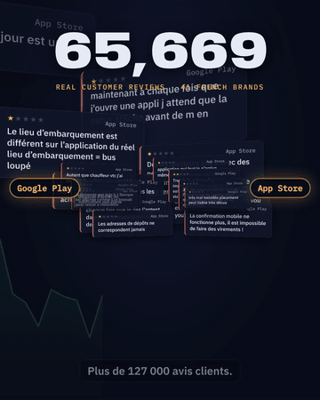
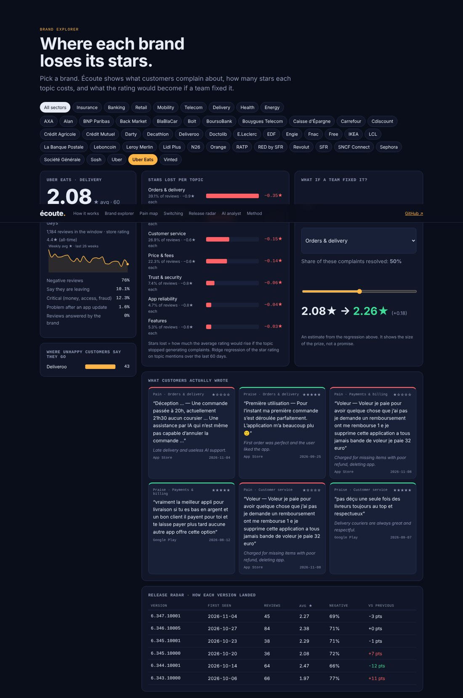

# écoute. — Always-on Voice of the Customer

**Every review, captured within minutes. Every issue, explained. Every fix, prioritised.**

*Écoute : l'écoute client en continu. Chaque avis capté en quelques minutes. Chaque irritant expliqué. Chaque action priorisée.*

[](https://github.com/narpatganwliya7/Voice-of-the-Customer-AI/actions/workflows/tests.yml)


<p align="center"></p>

Écoute is an AI agent that reads what customers of **41 French brands** write on Google Play and
the App Store (banks, insurers, telecom operators, retailers, mobility, delivery, energy, health),
turns every review into a structured signal, measures **how many stars each pain point costs**,
and investigates sudden spikes on its own, ending with a brief for the team that can fix them.

Everything runs on GitHub Actions with **free** AI only, and every number on the site and in the
film comes from the pipeline's own outputs.

| | |
|---|---|
| **127,479** real customer reviews | **41** brands across 8 sectors |
| **15** customer-experience topics | **4,300** reviews annotated by a free AI model |
| **0.66** topic F1 on 300 held-out reviews | **91%** tone accuracy on the same held-out set |

---

## What it finds (real outputs)

**Where the stars go.** At **Deliveroo**, delivery problems appear in 39% of recent reviews and
cost **0.43 stars** of an average rating of 2.49. Resolving half of them is worth about +0.21★.

**What broke, and when.** On **10 November 2026**, **E.Leclerc** received 48 negative reviews
against a usual 6.6 per day. The AI analyst queried the data, read the reviews and traced the spike
to **app version 11.0.1**: crashes at launch and failed logins. Its brief recommended a hotfix or
rollback (Mobile team) and regression tests on cold start and login. Every review it cited is one
it actually read.

**Who customers name instead.** Competitors mentioned in negative reviews form a switching map per
sector, built with exact name matching so every line traces back to real reviews.

<p align="center"></p>

---

## How it works

```mermaid
flowchart LR
  subgraph Fast lane · every review · no API calls
    A[Collect<br/>Google Play + App Store] --> B[Protect<br/>PII masked]
    B --> C[Classify<br/>local model · 15 topics,<br/>tone, churn, severity]
    C --> D[Explain<br/>DuckDB SQL · key drivers,<br/>spikes, releases, switching]
  end
  subgraph Deep lane · only what the numbers flag
    D -- spike / bad release --> E[AI analyst<br/>SQL + review search]
    E --> F[Brief<br/>owner · action · evidence]
  end
  D --> G[Website + film]
  F --> G
```

| Stage | How |
|---|---|
| **Capture** | Official apps are located for every brand and accepted only when the developer matches, so look-alike apps are never tracked. New reviews are pulled newest-first until the collector reaches what it already has. Each run logs the **measured** delay between a customer posting and Écoute having the review. |
| **Protect** | Usernames, avatars and platform ids are never stored. Emails, phone numbers, IBANs and account numbers pasted into reviews are masked. |
| **Understand** | A free LLM (Gemini free tier, model discovered at run time) annotates a stratified sample of 4,300 reviews against a 15-topic taxonomy. A local classifier (multilingual sentence embeddings + word and character TF-IDF + logistic regression) learns from it and scores every review in minutes, with no API cost. |
| **Explain** | DuckDB SQL models: brand scorecards, a brand × topic pain map, weekly trends, a release radar (each app version against the previous one), daily spike detection, and a ridge regression of star ratings on topic mentions: *stars lost = impact × prevalence*. |
| **Investigate** | The analyst agent receives each spike or bad release, works with three tools (read-only SQL, review search, key drivers), must back every number with a tool result, and files a structured brief. Cited reviews are checked against what it actually read. |
| **Show** | A static website (brand explorer, what-if simulator, pain map, switching map, release radar, agent console, method) and a launch film rendered from the same data, in which the agent replays its own logged investigation. |

The data lives on the `data` branch so `main` stays code only.

### Free AI only

| Job | Model | Cost |
|---|---|---|
| Annotating 4,300 reviews | Gemini Flash / Flash-Lite, free tier (falls through models when a daily quota is used up, resumes next run) | 0 |
| Scoring every review | Local scikit-learn model + `paraphrase-multilingual-MiniLM-L12-v2` on CPU | 0 |
| Investigations | Gemini free tier | 0 |
| Narration of the film | ElevenLabs free plan, "Cyril" voice, generated in the web app and credited in the film; aligned to the picture with faster-whisper on a GitHub runner | 0 |

---

## Model quality, honestly

| Check | Cross-validated | Held-out (300 reviews never used for training) |
|---|---:|---:|
| Topic detection, micro F1 | 0.65 | 0.66 |
| Topic detection, macro F1 | 0.63 | 0.61 |
| Overall tone, accuracy | 0.91 | 0.91 |
| Leaving the company, F1 | 0.50 | – |
| Topic polarity, accuracy | 0.94 | – |

These figures measure agreement with the AI annotator, not with human labels.

**Limits**
- App reviews over-represent strong opinions: a signal, not a survey.
- "Stars lost" comes from a regression: correlation, not proof of cause.
- Capture latency is reported only from live runs that measured it. The site says when live collection is paused.

---

## Run it

```bash
pip install -r requirements.txt
python -m ecoute collect --mode backfill --brands "Orange, SNCF Connect"
GEMINI_API_KEY=... python -m ecoute label --limit 400
python -m ecoute score --retrain && python -m ecoute insights
python -m ecoute site --out store/site
python -m pytest -q
```

Or from GitHub, in the **Actions** tab:

| Workflow | What it does |
|---|---|
| **Collect reviews** | New reviews for all brands or a chosen few. Uncomment the schedule for live mode (every 10 minutes). |
| **Annotate with free AI** | Labels the training sample; resumable when the free quota runs out. |
| **Analyse** | Trains the classifier, scores every review, builds insights, lets the AI analyst investigate, builds the website data. |
| **Video narration** | Aligns the recorded narration to the script with faster-whisper (word timings drive the cuts and the French subtitles). Kokoro and the ElevenLabs API remain as fallbacks. |

## Project layout

```
ecoute/        collector, resolver, taxonomy, free-LLM client, classifier, insights, agent, site builder
sql/           DuckDB models (facts, scorecard, heatmap, trends, releases, spikes, switching)
site/          static website (vanilla JS + D3)
video/         story builder, narration alignment, sound mix, Remotion + Three.js film
config/        brands and competitor dictionary
tests/         offline tests (no network)
```

## Why this transfers

The taxonomy (reliability, login, payments, service, delivery, trust…) is industry-neutral. Point
the collector at another set of apps (a car-maker's companion app, a SaaS product, a utility) and
the same pipeline answers the same questions: what hurts, how much, since when, and who should fix it.

---

**Disclaimer.** Independent portfolio project, not affiliated with or endorsed by any brand named here.
Brand names only identify the apps whose public reviews were analysed; no logos are used. Quotes are
short, anonymous and stripped of personal data. Figures marked as estimates come from a statistical
model, not from the companies. A brand that wants its name removed can open an issue.

Built by **Narpat Ganwliya** · Python · SQL · machine learning · AI agents · GitHub Actions
